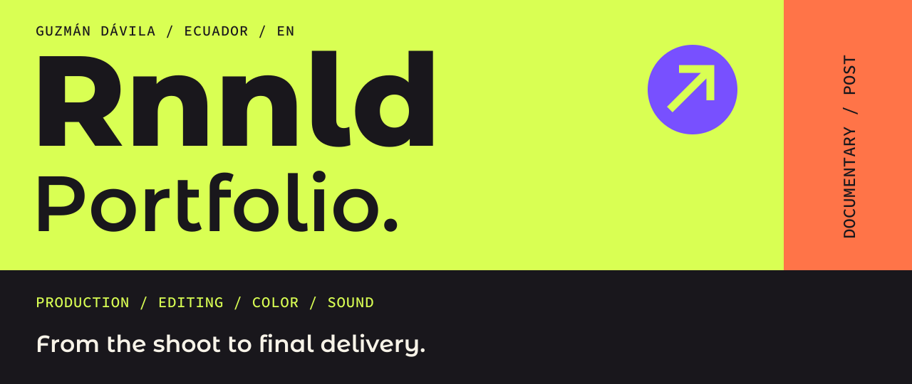

[Español](./PORTFOLIO_ES.md) / **ENGLISH** &nbsp; · &nbsp; [Home](./README.md) &nbsp; · &nbsp; [Get in touch ↗](https://wa.me/593979864314)

**Ronald Guzmán Dávila** · Independent audiovisual producer  
Based in Ecuador / Available for remote projects worldwide

End-to-end audiovisual production: directing, camera and postproduction, from the shoot to final delivery.

[Selected work](#work) &nbsp; / &nbsp; [Production + post](#process) &nbsp; / &nbsp; [Experience](#experience) &nbsp; / &nbsp; [Collaborations](#collaborations)

<h2></h2>

### PLAY / Reel

**[▶ Play reel ↗](https://youtu.be/rhUEiaQfEJ4)**

Production · Direction · Camera · Drone · Editing · Color · Audio post · Delivery

 

### 01 / Chimborazo
**Climate documentary · Revista Vistazo**

Production · Camera · Editing · Color · Audio post · Delivery

[▶ Watch documentary ↗](https://www.youtube.com/watch?v=ObqKy5h2I38)

 

### 02 / Editorial interviews
**Editorial production · Revista Vistazo**

Production · Camera · Editing · Color · Audio post

[▶ Watch interview ↗](https://www.youtube.com/watch?v=mGdqrWWpJr4)

### 03 / Clowder
**Web application development · Clowder Coffee House**

I developed Clowder's web application for browsing the catalog, selecting products and preparing orders for WhatsApp. The interface includes category navigation, a shopping cart, product options, payment information and installation on mobile devices.

**My work** / Interface development, ordering logic, menu configuration and web publishing.

[↗ Open and use the application](https://clowder.cafe/)

 

More documentary work

**Documentary production** · Direction, camera and postproduction.  
Project link coming soon.

 

<h2></h2>

**ON LOCATION** / Production · Direction · Camera · Drone operation

**IN POST** / Editing · Color correction · Audio postproduction

**FINAL DELIVERY** / Master preparation and delivery

Postproduction tools

DaVinci Resolve · Pro Tools · Ableton Live · iZotope RX

 

<h2></h2>

### Revista Vistazo
**2021–Present / Post producer & audiovisual producer**

End-to-end production of editorial and documentary projects: shooting, editing, color grading and audio postproduction. Delivery of **100+ audiovisual pieces annually**.

### Universidad Católica de Santiago de Guayaquil
**2015–2020 / Audiovisual Lab Supervisor**

Supervision of audiovisual production workflows, technical coordination and execution of multimedia projects.

 

<h2></h2>

**REMOTE PRODUCTION**  
Canoa Suites / United States

**COLOR FINISHING**  
NYU student documentary projects

**DOCUMENTARY**  
ICHE Gastronomy School

**AUDIO POST**  
Cervecería Nacional

**CORPORATE PRODUCTION**  
Veolia (Gadere) · Interagua · Ecotec University

**INSTITUTIONAL CAMPAIGNS**  
Ecuador's Ministry of Tourism · Prefectura del Guayas

 

<h2></h2>

Have a documentary, production or postproduction project in mind?

### [Get in touch ↗](https://wa.me/593979864314)

[LinkedIn](https://www.linkedin.com/in/ronaldgdavila/) &nbsp; / &nbsp; [Instagram](https://www.instagram.com/guzzmandro/) &nbsp; / &nbsp; [GitHub profile](https://github.com/guzmandavila)

---

[↑ Back to top](#) &nbsp; · &nbsp; [Español](./PORTFOLIO_ES.md) &nbsp; · &nbsp; [All portfolios](./README.md)
