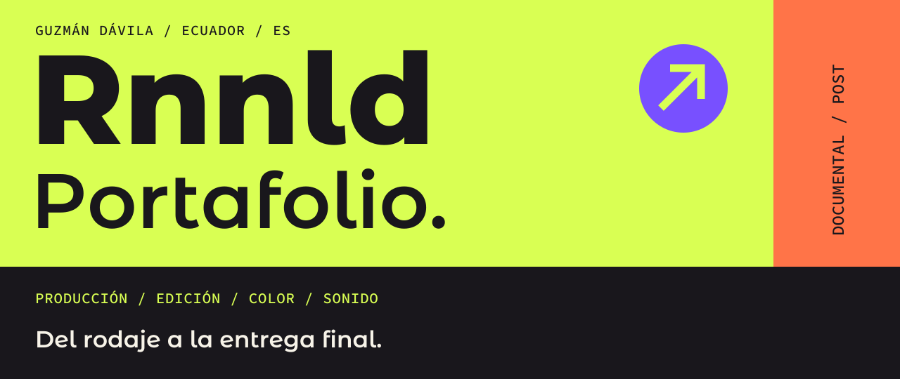
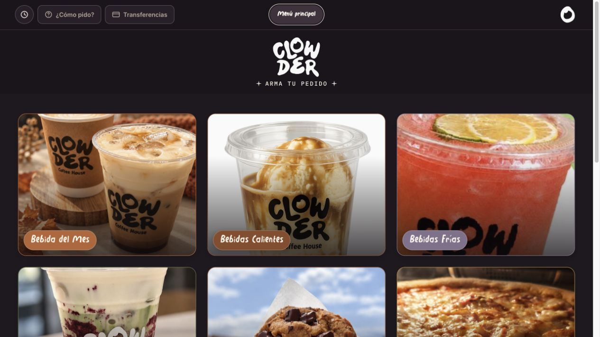

**ESPAÑOL** / [English](./PORTFOLIO_EN.md) &nbsp; · &nbsp; [Inicio](./README.md) &nbsp; · &nbsp; [Escríbeme ↗](https://wa.me/593979864314)

**Ronald Guzmán Dávila** · Productor audiovisual independiente  
Ecuador / Proyectos remotos a nivel internacional

Producción audiovisual integral: dirección, cámara y postproducción, desde el rodaje hasta la entrega final.

[Trabajos](#trabajos) &nbsp; / &nbsp; [Producción + post](#proceso) &nbsp; / &nbsp; [Trayectoria](#trayectoria) &nbsp; / &nbsp; [Colaboraciones](#colaboraciones)

<h2></h2>

### PLAY / Reel

**[▶ Reproducir reel ↗](https://youtu.be/rhUEiaQfEJ4)**

Producción · Dirección · Cámara · Dron · Edición · Color · Post de audio · Entrega final

 

### 01 / Chimborazo
**Documental ambiental · Revista Vistazo**

Producción · Cámara · Edición · Color · Post de audio · Entrega final

[▶ Ver documental ↗](https://www.youtube.com/watch?v=ObqKy5h2I38)

 

### 02 / Entrevistas editoriales
**Producción editorial · Revista Vistazo**

Producción · Cámara · Edición · Color · Post de audio

[▶ Ver entrevista ↗](https://www.youtube.com/watch?v=mGdqrWWpJr4)

### 03 / Clowder
**Desarrollo de aplicación web · Clowder Coffee House**

Desarrollé la aplicación web de Clowder para consultar el catálogo, seleccionar productos y preparar pedidos para WhatsApp. La interfaz incluye navegación por categorías, carrito, opciones de productos, información de pagos e instalación en dispositivos móviles.

**Trabajo realizado** / Desarrollo de interfaz y lógica de pedidos, configuración del menú y publicación web.

[↗ Abrir y usar la aplicación](https://clowder.cafe/)

 

Más trabajo documental

**Producción documental** · Dirección, cámara y postproducción.  
Enlace del proyecto próximamente.

 

<h2></h2>

**EN CAMPO** / Producción · Dirección · Cámara · Operación de dron

**EN POST** / Edición · Corrección de color · Postproducción de audio

**EN LA ENTREGA** / Preparación del máster y entrega final

Herramientas de postproducción

DaVinci Resolve · Pro Tools · Ableton Live · iZotope RX

 

<h2></h2>

### Revista Vistazo
**2021–Presente / Postproductor y productor audiovisual**

Producción integral de proyectos editoriales y documentales: grabación, edición, corrección de color y postproducción de audio. Entrega de **más de 100 piezas audiovisuales anuales**.

### Universidad Católica de Santiago de Guayaquil
**2015–2020 / Responsable de Laboratorio Audiovisual**

Supervisión de flujos de producción audiovisual, coordinación técnica y ejecución de proyectos multimedia.

 

<h2></h2>

**PRODUCCIÓN REMOTA**  
Canoa Suites / Estados Unidos

**COLOR**  
Documentales de estudiantes de NYU

**DOCUMENTAL**  
Escuela gastronómica ICHE

**AUDIO**  
Cervecería Nacional

**PRODUCCIÓN CORPORATIVA**  
Veolia (Gadere) · Interagua · Ecotec

**CAMPAÑAS INSTITUCIONALES**  
Ministerio de Turismo del Ecuador · Prefectura del Guayas

 

<h2></h2>

¿Tienes un proyecto de documental, producción o postproducción?

### [Escríbeme ↗](https://wa.me/593979864314)

[LinkedIn](https://www.linkedin.com/in/ronaldgdavila/) &nbsp; / &nbsp; [Instagram](https://www.instagram.com/guzzmandro/) &nbsp; / &nbsp; [Perfil de GitHub](https://github.com/guzmandavila)

---

[↑ Volver al inicio](#) &nbsp; · &nbsp; [English](./PORTFOLIO_EN.md) &nbsp; · &nbsp; [Todos los portafolios](./README.md)
